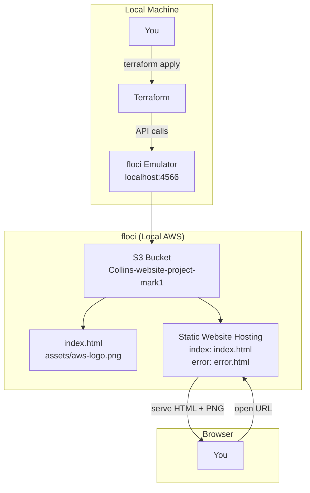
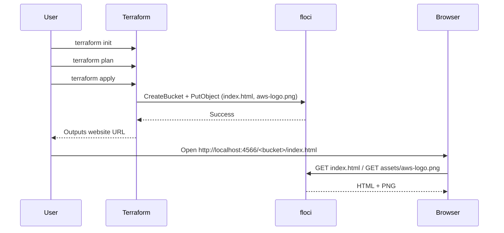

# floci Static Website on S3


This project deploys a static website to an S3 bucket using **Terraform** against **floci** (a local AWS emulator). No real AWS account is used — everything runs locally on `http://localhost:4566`.

## What this project does

1. Creates an S3 bucket (`Collins-website-project-mark1`)
2. Uploads `index.html` and `assets/aws-logo.png` as website objects
3. Enables static website hosting on the bucket (index doc: `index.html`, error doc: `error.html`)
4. Serves the site locally via floci so you can open it in a browser

## Prerequisites

- [Terraform](https://developer.hashicorp.com/terraform/downloads) installed
- [floci](https://floci.dev) running locally
- (Optional) AWS CLI for direct bucket operations

## Project structure

```text
hosting-website-s3/
├── assets/
│   └── aws-logo.png        # Website logo (uploaded to S3)
├── index.html              # Website homepage (uploaded to S3)
├── error.html              # Custom 404 error page
├── main.tf                 # Terraform resources: bucket, objects, website config
├── variable.tf             # Input variables (bucket name, region, keys, endpoint)
├── version.tf              # Provider requirements + AWS provider config
├── output.tf               # Outputs: bucket name, ARN, website URL, object keys
├── .gitignore              # Git ignore rules
└── README.md               # This file
```

## Architecture



## Lifecycle sequence diagram



## Setup & usage

### 1. Start floci

```powershell
floci start
```

### 2. Load the local endpoint

```powershell
$env:AWS_ENDPOINT_URL="http://localhost:4566"
```

### 3. Initialize Terraform

```powershell
terraform init
```

### 4. Preview changes (dry run)

```powershell
terraform plan
```

### 5. Deploy

```powershell
terraform apply -auto-approve
```

### 6. View outputs

```powershell
terraform output
```

Open the `website_url` in your browser to see the site served by floci.

### 7. Cleanup

```powershell
terraform destroy -auto-approve
floci stop
```

## File-by-file explanation

| File | Purpose |
|------|---------|
| `version.tf` | Declares the AWS provider (`~> 6.70`) and configures it to talk to floci at `localhost:4566` with path-style S3 and account-ID skipping. |
| `variable.tf` | Defines input variables: `bucket_name`, `region`, `tags`, `access_key`, `secret_key`, `endpoint`. |
| `main.tf` | Creates the S3 bucket, enables versioning and ownership controls, uploads `index.html` and `assets/aws-logo.png`, and enables static website hosting with `index.html` and `error.html`. |
| `output.tf` | Exposes `bucket_name`, `bucket_arn`, `website_url`, and `index_object_key` after apply. |
| `index.html` | Website homepage, uploaded to S3 as `index.html`. |
| `error.html` | Custom 404 page, used as the website error document. |
| `assets/aws-logo.png` | Website logo, uploaded to S3 as `assets/aws-logo.png`. |

## Git ignore

State files and the local `.terraform` directory are ignored. The provider lock file (`.terraform.lock.hcl`) should **not** be ignored — it pins provider versions and belongs in version control.

## floci notes

- State is disposable: `floci stop` then `floci start` gives you a clean emulator.
- Never run against a real AWS account with this config — it targets `localhost:4566` only.
- Credentials `test`/`test` are used because floci does not validate them.
